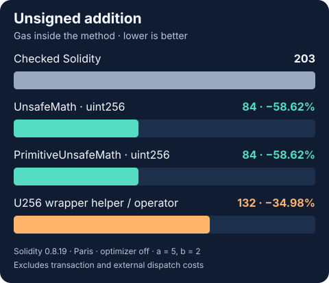

<p align="center">
  
</p>

<h1 align="center">Unsafe Math</h1>

<p align="center">Wrapping arithmetic. Familiar operators. Explicit EVM semantics.</p>

<p align="center">
  <a href="#choose-your-api">Choose an API</a> ·
  <a href="#quick-start">Quick start</a> ·
  <a href="#gas-results">Gas results</a> ·
  <a href="#development">Development</a>
</p>

Unchecked `uint256` and `int256` arithmetic for Solidity, plus `U256` and `I256` types with overloaded operators and conversions at every integer width. Internal functions compile into your contract, so no library deployment or linking is required.

## Choose your API

| You need | Import from `@0xdoublesharp/unsafe-math/` | Minimum Solidity |
| :--- | :--- | :--- |
| Arithmetic on ordinary integers | `contracts/PrimitiveUnsafeMath.sol` | **0.8.0** |
| Arithmetic, wrapper helpers, casts, and shifts | `contracts/UnsafeMath.sol` | **0.8.19** |
| Operators on unsigned wrappers | `contracts/types/U256.sol` | **0.8.19** |
| Operators on signed wrappers | `contracts/types/I256.sol` | **0.8.19** |

`PrimitiveUnsafeMath` is standalone and imports no wrapper types. Existing `UnsafeMath` imports keep their full API. Tests run on Solidity **0.8.35**, with separate checks on the actual **0.8.0** and **0.8.19** minimums. Gas comparisons stay pinned to **0.8.19**.

## Quick start

```sh
pnpm add @0xdoublesharp/unsafe-math
```

For arithmetic on ordinary integers, start here:

```solidity
// SPDX-License-Identifier: MIT
pragma solidity ^0.8.0;

import {PrimitiveUnsafeMath} from '@0xdoublesharp/unsafe-math/contracts/PrimitiveUnsafeMath.sol';

contract Counter {
    using PrimitiveUnsafeMath for uint256;

    function next(uint256 value) external pure returns (uint256) {
        return value.inc();
    }
}
```

`next(type(uint256).max)` returns `0`. `PrimitiveUnsafeMath` provides the same unsigned and signed arithmetic methods listed below for `UnsafeMath`. Use these operations when wrapping is intended or your caller has already established bounds.

> [!IMPORTANT]
> Division and modulo by zero return **0**. Solidity's ordinary `unchecked` division and modulo still revert on zero. Choose the behavior your contract requires.

## Arithmetic and conversion semantics

- Addition, subtraction, multiplication, increment, decrement, and unsigned exponentiation wrap modulo 2^256. Signed results use two's complement.
- Division and modulo return **zero when the divisor is zero**, including `0 / 0` and `0 % 0`. This follows the EVM's `DIV`, `SDIV`, `MOD`, and `SMOD` instructions. Solidity's ordinary `unchecked` division and modulo still revert on a zero divisor.
- Signed division truncates toward zero. Signed modulo takes the sign of the dividend. `int256.min / -1` returns `int256.min`, and `int256.min % -1` returns zero.
- Unsigned exponentiation returns one for `0 ** 0` and wraps on overflow.
- Casts discard higher bits without range checks. Signed casts interpret the remaining sign bit, so `U256.wrap(255).asInt8()` returns `-1`. Wrapping between signed and unsigned values preserves all 256 bits.
- Left shifts discard higher bits. Both shift directions return zero for counts of 256 or greater.

Use these operations only where their semantics match the caller's requirements. Arithmetic can save gas when overflow checks are unnecessary. Wrapper calls, comparisons, and bitwise operations can cost more gas with the optimizer disabled. See [gas guidance](GAS_REPORT.md).

## Unsigned arithmetic with the full library

Add `using UnsafeMath for uint256;` to use `add(uint256)`, `sub(uint256)`, `mul(uint256)`, `div(uint256)`, `mod(uint256)`, `exp(uint256)`, `inc()`, and `dec()`.

```solidity
// SPDX-License-Identifier: MIT
pragma solidity ^0.8.19;

import {UnsafeMath} from '@0xdoublesharp/unsafe-math/contracts/UnsafeMath.sol';

contract UnsignedMethods {
    using UnsafeMath for uint256;

    function add(uint256 a, uint256 b) external pure returns (uint256) {
        return a.add(b);
    }

    function countDown(uint256 times) external pure returns (uint256 iterations) {
        while (times != 0) {
            times = times.dec();
            iterations = iterations.inc();
        }
    }
}
```

## Signed arithmetic with the full library

Add `using UnsafeMath for int256;` to use `add(int256)`, `sub(int256)`, `mul(int256)`, `div(int256)`, `mod(int256)`, `inc()`, and `dec()`. Signed exponentiation is not provided.

```solidity
// SPDX-License-Identifier: MIT
pragma solidity ^0.8.19;

import {UnsafeMath} from '@0xdoublesharp/unsafe-math/contracts/UnsafeMath.sol';

contract SignedMethods {
    using UnsafeMath for int256;

    function sub(int256 a, int256 b) external pure returns (int256) {
        return a.sub(b);
    }
}
```

## U256 helper methods

Add `using UnsafeMath for U256;`.

- Arithmetic: `add(uint256)`, `sub(uint256)`, `mul(uint256)`, `div(uint256)`, `mod(uint256)`, `exp(uint256)`, `inc()`, `dec()`.
- Comparison: `eq(uint256)`, `neq(uint256)`, `lt(uint256)`, `lte(uint256)`, `gt(uint256)`, `gte(uint256)`.
- Bitwise: `and(uint256)`, `or(uint256)`, `xor(uint256)`, `not()`.
- Shifts: `lshift(uint256)` and `lshift(U256)` shift left; `rshift(uint256)` and `rshift(U256)` shift right.
- Conversions: `asUintN()` and `asIntN()` for every multiple of eight from 8 through 256, including `asUint232()`, `asUint240()`, and `asUint248()`.
- Wrapping: `uint256.asU256()` and `int256.asU256()`, after enabling `UnsafeMath` for the primitive type. Solidity also provides `U256.wrap(uint256)` and `U256.unwrap(U256)`.

```solidity
// SPDX-License-Identifier: MIT
pragma solidity ^0.8.19;

import {UnsafeMath, U256} from '@0xdoublesharp/unsafe-math/contracts/UnsafeMath.sol';

contract UnsignedHelpers {
    using UnsafeMath for U256;
    using UnsafeMath for uint256;
    using UnsafeMath for int256;

    function add(int256 a, uint256 b) external pure returns (uint256) {
        return a.asU256().add(b).asUint256();
    }

    function sub(uint256 a, uint256 b) external pure returns (uint256) {
        return (a.asU256() - b.asU256()).asUint256();
    }
}
```

## I256 helper methods

Add `using UnsafeMath for I256;`. Binary helper arguments are signed `int256` values.

- Arithmetic: `add(int256)`, `sub(int256)`, `mul(int256)`, `div(int256)`, `mod(int256)`, `inc()`, `dec()`.
- Comparison: `eq(int256)`, `neq(int256)`, `lt(int256)`, `lte(int256)`, `gt(int256)`, `gte(int256)`.
- Bitwise: `and(int256)`, `or(int256)`, `xor(int256)`, `not()`.
- Conversions: `asUintN()` and `asIntN()` for every multiple of eight from 8 through 256.
- Wrapping: `uint256.asI256()` and `int256.asI256()`, after enabling `UnsafeMath` for the primitive type. Solidity also provides `I256.wrap(int256)` and `I256.unwrap(I256)`.

```solidity
// SPDX-License-Identifier: MIT
pragma solidity ^0.8.19;

import {UnsafeMath, I256} from '@0xdoublesharp/unsafe-math/contracts/UnsafeMath.sol';

contract SignedHelpers {
    using UnsafeMath for I256;
    using UnsafeMath for uint256;

    function sub(uint256 a, uint256 b) external pure returns (int256) {
        I256 left = a.asI256();
        I256 right = b.asI256();
        return (left - right).asInt256();
    }
}
```

## U256 operators

Importing the type enables `+`, `-`, `*`, `/`, `%`, `==`, `!=`, `<`, `<=`, `>`, `>=`, `&`, `|`, `^`, and `~` for two `U256` operands, or one operand for `~`. Shift and exponentiation operators cannot be overloaded; use the helper methods.

```solidity
// SPDX-License-Identifier: MIT
pragma solidity ^0.8.19;

import {U256} from '@0xdoublesharp/unsafe-math/contracts/types/U256.sol';

contract UnsignedOperators {
    function add(uint256 a, uint256 b) external pure returns (uint256) {
        return U256.unwrap(U256.wrap(a) + U256.wrap(b));
    }
}
```

## I256 operators

The same binary arithmetic, comparison, and bitwise operators are provided for `I256`. Unary negation, signed shifts, and signed exponentiation are not provided.

```solidity
// SPDX-License-Identifier: MIT
pragma solidity ^0.8.19;

import {I256} from '@0xdoublesharp/unsafe-math/contracts/types/I256.sol';

contract SignedOperators {
    function add(int256 a, int256 b) external pure returns (int256) {
        return I256.unwrap(I256.wrap(a) + I256.wrap(b));
    }
}
```

## Gas results



These are gas units measured **inside the test method**, excluding transaction and external dispatch costs. With operands `5` and `2`, both `UnsafeMath` and `PrimitiveUnsafeMath` use **84 gas** for their ordinary `uint256` addition methods, versus 203 for checked Solidity. The **132 gas** result belongs to the `U256` wrapper helpers and operators. The standalone library provides older-compiler compatibility with the same arithmetic implementations and gas costs. Comparisons and bitwise wrappers cost more than ordinary Solidity under these settings.

See the [gas report](GAS_REPORT.md) for all arithmetic results, wrapper overhead, compiler settings, and reproduction steps. Measure your own compiler and optimizer configuration before making gas claims.

## Development

Use **Node.js 22**, **pnpm 11.21.0**, and **Foundry v1.8.5**. Tests are native Solidity, with no Hardhat, TypeScript, or forge-std dependency. The launcher downloads pinned native compilers from Solidity's official distribution and verifies their checksums and versions.

On macOS, put the checkout, dependencies, and temporary files on Scratch:

```sh
mkdir -p /Volumes/Scratch/unsafe-math/worktrees /Volumes/Scratch/unsafe-math/tmp/dev
export TMPDIR=/Volumes/Scratch/unsafe-math/tmp/dev
git clone https://github.com/doublesharp/unsafe-math.git /Volumes/Scratch/unsafe-math/worktrees/dev
cd /Volumes/Scratch/unsafe-math/worktrees/dev
nvm use
pnpm install --frozen-lockfile --store-dir /Volumes/Scratch/unsafe-math/tmp/dev/pnpm-store
pnpm validate
```

| Command | Checks |
| :--- | :--- |
| `pnpm test` | Correctness and boundary tests on Solidity 0.8.35; 256 runs per fuzz test |
| `pnpm test:compat` | Primitive tests on 0.8.0, full correctness suite on 0.8.19 |
| `pnpm coverage` | Every production file; exact counters must reach 100% |
| `pnpm test:gas` | Uninstrumented comparisons on 0.8.19, Paris EVM, optimizer disabled |
| `pnpm check:docs` | Each of the seven examples above compiles on its minimum compiler |
| `pnpm check:package` | Exact archive contents, extracted full-API compilation, extracted primitive tests |
| `pnpm test:tools` | Coverage and gas-report gates reject incomplete results |
| `pnpm validate` | All of the above, with gas measurements after coverage |

Builds, compilers, caches, and reports default to `/Volumes/Scratch/unsafe-math/build/<checkout>-<path-hash>`. The launcher stops if Scratch is missing. On an ephemeral CI runner, set `UNSAFE_MATH_BUILD_DIR` and `TMPDIR` to absolute disposable directories. CI runs the same locked install and validation command.

Coverage includes all four production files and every conversion width, wrapper, and shift overload. Branch coverage is reported as N/A because the production files have no instrumented branches. Correctness tests explicitly cover the exceptional arithmetic cases described above.

[Changelog](CHANGELOG.md) · [MIT license](LICENSE)
